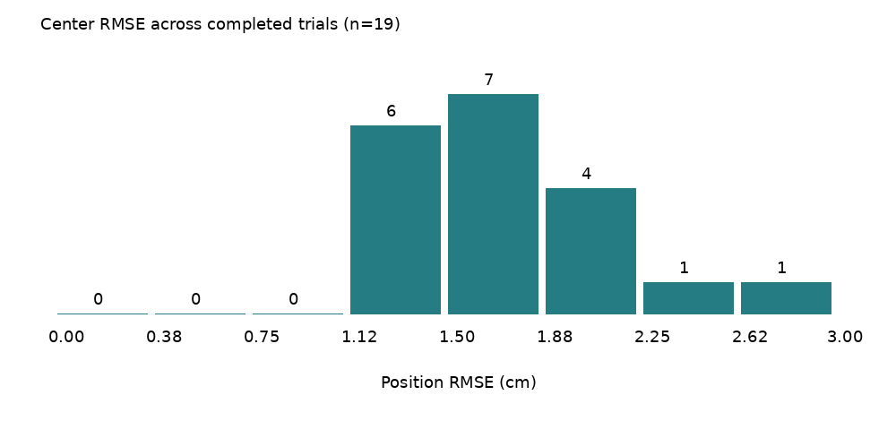

# 20 个随机散箱摆 NYU · 独立种子复验

## 本轮结果

种子 9800–9819，每个种子从初始状态运行一次。联合成功率为 **19/20（95%）**，Wilson 95% 区间 76.4%–99.1%。
完整搬运、最终落稳且由 20 个不同实体组成的场次为 19/20。单看字形和搬运完整性为 19/20。
完整场次箱心 RMSE 中位数 1.58 cm，范围 1.28–2.93 cm。完整场次中最大的单箱朝向偏差为 2.68°。

上一轮 9600–9619 为 18/20（90%）。两轮初始布局不同，不能把比例差归因为代码优化。本轮恢复原有四个补看姿态，额外两个角度已撤回；中止的 9700 系列没有计入分母。未用本轮失败种子调整控制器。



## 两个代表回放

- 箱心误差接近成功场次中位数，种子 [9814](seed_9814/replay.mp4)，箱心 RMSE 1.58 cm，最大角差 1.38°。
- 其余成功场次中单箱朝向偏差最大，种子 [9812](seed_9812/replay.mp4)，箱心 RMSE 2.93 cm，最大角差 2.68°。

## 放手复查与失败分析

- 种子 9801：停止时已登记 19 次摆放，轨迹中对应 19 个不同箱子，终态有 19 个箱子落地。停止原因：lost box neighborhood at lift (19)。

日志记录了 399 次松手后的视觉复查，其中第 2 次及以后的释放共 0 次。复查发生在手边，视角内误差和全局对齐后的独立终态误差分别统计。[每次复查读数](release-checks.json)

## 回放和逐场数据

回放按同一条物理轨迹同步重绘九路 RGB-D 和右侧跟拍，每个视频帧展示该时刻可获取的画面。控制算法实际按需取图。末尾切至外部俯视以便检查全字形。

## 每次运行

|种子|已放 / 不同实体 / 落地|箱心 RMSE (cm)|最远 (cm)|箱边 RMS (°)|最歪 (°)|结果或停止原因|
|---:|---|---:|---:|---:|---:|---|
|9800|20 / 20 / 20|1.96|6.36|0.78|2.08|通过|
|9801|19 / 19 / 19|105.82|442.84|10.61|36.51|lost box neighborhood at lift (19)|
|9802|20 / 20 / 20|1.39|3.03|0.75|2.03|通过|
|9803|20 / 20 / 20|2.03|3.60|0.66|1.71|通过|
|9804|20 / 20 / 20|2.25|4.01|1.22|2.61|通过|
|9805|20 / 20 / 20|1.54|3.18|0.59|0.99|通过|
|9806|20 / 20 / 20|1.93|3.84|1.02|1.75|通过|
|9807|20 / 20 / 20|1.85|3.35|1.04|1.76|通过|
|9808|20 / 20 / 20|1.61|2.69|0.74|1.24|通过|
|9809|20 / 20 / 20|1.43|2.40|0.62|1.49|通过|
|9810|20 / 20 / 20|1.46|2.12|0.64|1.29|通过|
|9811|20 / 20 / 20|1.50|3.74|0.89|2.04|通过|
|9812|20 / 20 / 20|2.93|10.64|1.02|2.68|通过|
|9813|20 / 20 / 20|1.57|2.69|1.14|2.11|通过|
|9814|20 / 20 / 20|1.58|3.68|0.75|1.38|通过|
|9815|20 / 20 / 20|1.99|3.54|0.86|1.67|通过|
|9816|20 / 20 / 20|1.28|2.75|0.79|1.32|通过|
|9817|20 / 20 / 20|1.86|3.25|0.61|1.44|通过|
|9818|20 / 20 / 20|1.57|2.64|0.72|1.39|通过|
|9819|20 / 20 / 20|1.41|2.94|0.63|1.10|通过|

中途停止的场次也对现场全部 20 个物体评分，此时数值包含仍散放的箱子。各场保留 result.json 中的逐槽误差、实体分配和搬运记录。[逐场 CSV](trials.csv)

## 设定、控制与测量

**场景与物理。** 在 5.2 × 4.8 m 的区域内抽取 20 个中心，相邻散箱初始中心距大于 0.80 m，水平朝向独立随机。机器人随机朝向，从离最近箱子 1.05–2.2 m 的位置出发。方箱边长 26 cm、质量 0.6 kg。MuJoCo 以 2 ms 步长积分。底盘接收四个轮子执行器的速度指令，角速度传感器抑制短时转动。双臂和两手执行关节动作，由接触和摩擦将箱子抬起并运输。初始布局由场景生成器持有；控制器启动时只接收形状模板与传感器接口。

**巡查与跨镜头关联。** 四向巡查相机从深度图中提取橙色箱顶，低位相机也可从侧面拟合箱心。相机内参和机身关节角把观测换算到底盘坐标，同次扫描里相距不足约 24 cm 的检测合并。建立箱群记忆时，以第一帧中一个箱子为原点，保存每箱的二维相对坐标。下一次看到一组箱子，先比较整组位移，选择能同时解释较多邻居的偏移，再做一对一最小代价匹配，残差小于 26 cm 才接纳。箱对的方向变化提供局部朝向估计。巡查期间可用一致的重复观测修正记忆坐标；箱子至少多次匹配且从不同位置看过，才计为已确认。外观相同的箱子没有视觉序列号。

**如何选择目标和移动。** 巡查完整后，把形状模板移到散箱附近的候选空地。规划器在栅格上检查底盘、手部及持箱空间，评估取放站位能否连通，并优先保留附近可观测的参照。由此选择源箱、目的槽和搬运顺序。行驶时反复询问“根据此刻看见的几个箱子，目标在手的哪个方向？”每个已匹配箱的当前观测，加上记忆中从它到目标的向量，都给出一次估计，取中位数得到当前目标。沿避障路线走一小步，再看一次。这里估计了箱群相对车身的平面方向和平移关系；没有累计车轮行程，也没有用地面纹理、视觉里程计或房间地图求车身世界位姿。

**抓取、释放与记账。** 抓取区从侧面点云估计箱边方向，底盘小幅旋转和平移，把手对准箱面后夹起。通过头部或近摄视角核实抬箱。搬起的箱子移出静止参照集合；其它箱子给出槽位相对车身的位置。到位后放手，看落箱的真实可见箱面并复测。局部估计的角差须 ≤3.8°、中心偏差须 ≤7.5 cm；超限则重新抓放，最多九次释放。通过复查才登记新槽位和落箱观测。碰撞、打滑或遮挡仍可能破坏后续对应。没有持续可用的参照时会搜索，搜索失败会停止。

**实际用到的相机与时序。** 四台机身前、后、左、右巡查相机，三台底盘左前、右前、后方低位相机，以及头部和底盘近摄相机，共九台，观测范围 4.15 m。没有固定的“每台每秒几张”。导航中通常每发出约 0.30 s 的运动指令后更新观测；每 11 次循环优先做一次全扫描，单镜头匹配不足三个也会提前全扫。巡查阶段的全扫使用四向镜头，搬运阶段全扫可用九台。抓箱、刹停、转头和对正有独立的观测节奏。腕部镜头没有参与控制。

**独立评分。** 评估器在运行结束后才读取物理世界中的箱心与姿态。检查 20 个释放记录、轨迹中的抬箱实体是否不同，以及终态中心高度是否离 13 cm 小于 1.5 cm。多初值平面刚体对齐与一对一分配估计槽位对应，允许全字整体平移和旋转。箱心 RMSE <10 cm 且最大误差 <18 cm 才算字形通过。按方箱的 90° 对称性计算朝向残差，相对字形轴的 RMS ≤5° 且最大值 ≤10° 才算联合成功。分母包括中途停止的全部种子。直方图只统计完整场次的逐场箱心 RMSE。

**适用范围。** 实验依赖标定的机载深度、颜色和大小一致的方箱、较平整地面、箱群局部重叠可见以及已知的物体数量。完全遮挡后，同色且邻域对称的箱子可能互换身份。小样本区间描述这个生成器的抽样不确定性；室内杂物、真实深度噪声、新箱型及其它本体尚需另测。

**整理后的校验。** 将本版评分器应用于上一轮保留的全部 20 条物理轨迹，通过与否、不同抬箱实体数、落地数与历史记录逐场一致；各场箱心 RMSE 与旧记录的最大差值小于 0.00004 cm。种子 9605 的新旧本体初始化关节与箱体状态向量逐项一致。新旧入口分别只装载执行所需的模型资产和上肢抓取动作，现有实现无需读取过去的 NYU 成功轨迹来执行新种子。

## 本轮讨论与复现

**第 20 箱为何没能放下。** 种子 9801 的前 19 箱均已完成松手复查。最后一轮日志停在抬箱阶段，此时搬起的箱子会被排除在静止参照之外。机器人的可见观测无法与记忆中的静止箱群建立足够的对应，搜索也没有恢复关联，因而没有执行最后一次放置。终态确有 19 个箱子在地面。上一轮种子 9604 也出现过相同的阶段和停止原因。现有日志能确认匹配失败，无法把原因进一步归结为某一台相机被遮挡或某一个箱子被认错。

**如何阅读这次的 95%。** 19 场成功均满足不同物体数、落地数、字形和朝向四类约束。种子 9812 的箱心 RMSE 为 2.93 cm，但其中一个箱子偏离槽位 10.64 cm；均方根较小并不代表每箱都同样准。它仍低于预先设定的 18 cm 单箱上限。这也是同时报告均方根、最差单箱和完整成功率的原因。

**复现这批实验。** 仓库根目录安装锁定依赖后，可用下列命令在新的输出目录复跑全部种子。并发数按主机可用内存、CPU 和图形设备调整。报告配套的两个种子还保留了原始物理轨迹，可以直接重绘回放。

```bash
for seed in $(seq 9800 9819); do
  MUJOCO_GL=egl python -m arrangement runs/reproduction "$seed"
done
python -m arrangement.render experiments/nyu-9800/seed_9814 replay-9814.mp4
python -m arrangement.render experiments/nyu-9800/seed_9812 replay-9812.mp4
```
